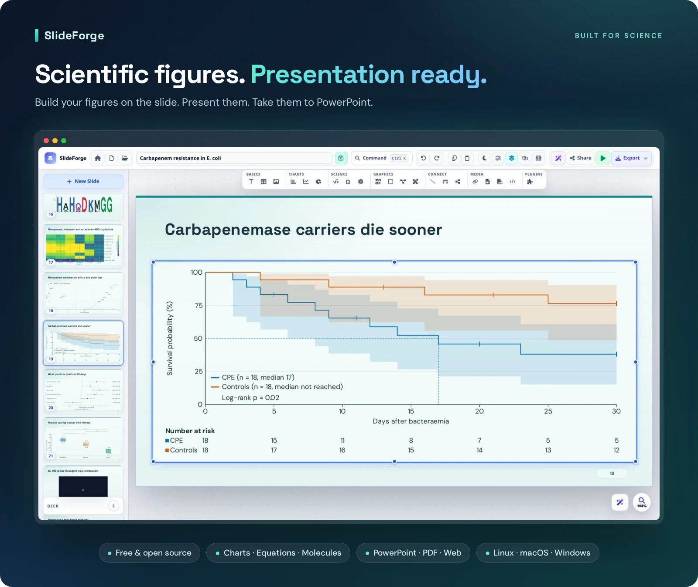
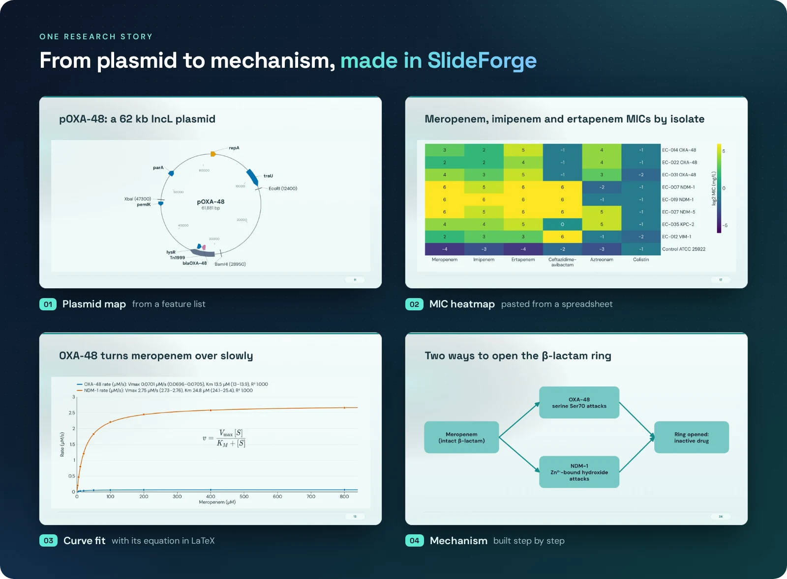
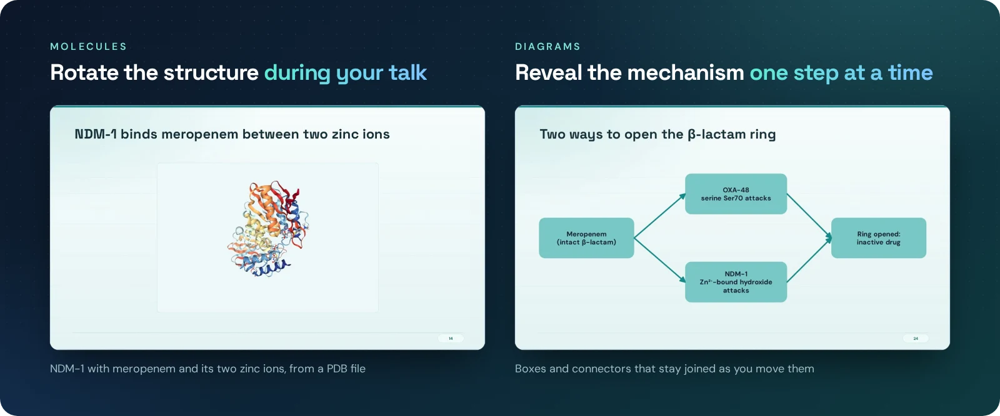
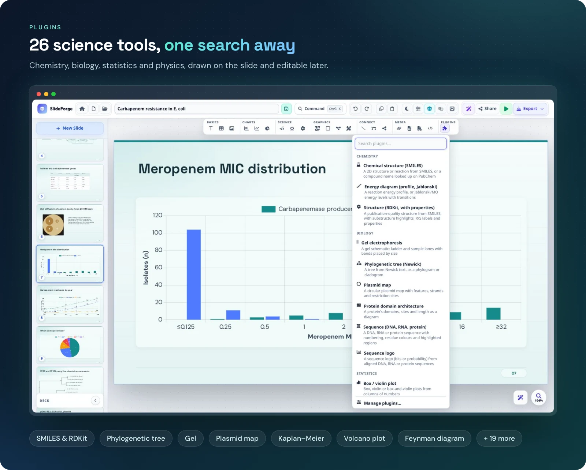

<div align="center">

# SlideForge

**Scientific figures. Presentation ready.**

The free desktop presentation app for researchers, teachers and students.
Build charts, equations and molecular views directly on your slides, then present or export to PowerPoint and PDF.

[**Install SlideForge**](#install) · [Documentation](https://dmighty007.github.io/slideforge-studio/) · [Live showcase](https://dmighty007.github.io/slideforge-studio/showcase/) · [Desktop guide](docs/DESKTOP.md)

Free & open source · Local deck storage · Linux, macOS & Windows



</div>

## Why SlideForge

Your next lab meeting, lecture or conference talk starts with your data. Paste a table to build a chart,
type LaTeX for an equation, or open a structure file for a molecule you can rotate during your talk.
Keep the figure and the story together as your slides take shape.

| Build the figure | Tell the story | Take it with you |
|---|---|---|
| Editable charts, curve fits, equations and science tools on the canvas. | Reveal a mechanism step by step, rotate a molecule, and present with notes. | Import PowerPoint or Keynote. Export PowerPoint, searchable PDF or an offline web presentation. |

**Your decks stay on your computer.** The desktop app needs no account to get started.

## What you can make



**See it play:** the [showcase](https://dmighty007.github.io/slideforge-studio/showcase/) has two decks made in
SlideForge that run in your browser through its web export, with charts, fits, plugins and a protein you can turn.

**Start with your data.** Paste spreadsheet values for a chart, enter an equation, or load a molecular structure.
Then arrange your slide and present it.

<details>
<summary><strong>Explore the built-in science and presentation tools</strong></summary>

| | |
|---|---|
| **Charts and tables** | Paste a block from a spreadsheet: it becomes a bar, line or pie chart with axis titles, error bars and values on the chart. A long table splits across slides with its header repeated. |
| **Equations** | Type LaTeX, get a crisp equation that exports as a picture PowerPoint can show. |
| **Landscapes** | Plot a CSV grid or `f(x, y)` as a heatmap, contours or a rotatable 3D surface. Inspect values while presenting; PowerPoint and PDF keep a still of the saved view. |
| **Molecules** | Open a PDB, CIF, XYZ or trajectory file and turn it with the mouse while you present. Bound drugs and metal ions are drawn so the room can see them. |
| **Chemistry** | Structures and reactions from SMILES or a compound name, RDKit drawings with properties, energy diagrams. |
| **Biology** | Plasmid maps, protein domains, sequences and sequence logos, phylogenetic trees, gels. |
| **Statistics** | Box and violin plots with tests, curve fits (dose–response, Michaelis–Menten, decay) with their units, forest plots, Kaplan–Meier curves, volcano plots, heatmaps, Venn diagrams. |
| **Diagrams** | Flowcharts you draw or type (Mermaid), shapes joined by arrows that follow them, and hand-drawn sketches. |
| **Media** | Pictures you can crop, looping videos, sounds that play on a click or when the slide opens, PDF pages, web embeds. |
| **References** | A citation from a DOI, a QR code to the paper, a scale bar for a micrograph. |

</details>



## Present it

- Full-screen show with a presenter view, notes and a timer.
- Bullets that appear one at a time, diagrams that build in the order you choose, and animations from fades to motion
  paths. Open [the animation showcase](docs/examples/animation-showcase.json) to see them all.
- Slides you keep for questions can be hidden from the show, and sounds can play without showing a player.
- A laser pointer, spotlight and chalkboard for the questions afterwards.
- A view-only link to share the deck, which follows your later edits and can be switched off.

## Bring your decks

Open a PowerPoint (.pptx) or Keynote (.key) file and keep working on it. Text keeps its fonts, sizes, spacing and
bullets; pictures keep their crops; and the template's logos and bars, shapes, transitions, builds, videos and
sounds come along, with PowerPoint's SmartArt diagrams, tables and charts too. When a deck uses a font this
computer doesn't have, SlideForge uses the fonts the file carries, offers to download it from Google Fonts, or
takes a font file you have, so lines break where the author's did. Computer Modern (CMU) and a stand-in for Cambria
Math come with the app.

A PDF opens too, to present it as it is: a talk from Beamer, or a deck someone sent as PDF. Each page becomes a
slide (a picture of the page, so its text cannot be edited), its links still work, and the show, presenter view,
notes, laser pointer and anything you add over a page work as on any slide.

Import results depend on the source deck. Check layout, fonts, media and builds before a talk, especially for
complex templates. Exported PowerPoint keeps supported text, shapes, tables and charts editable; specialized
scientific visuals may export as images. Keep the SlideForge deck to continue editing those visuals.

## Install

**Linux and macOS:** paste this into a terminal.

```bash
curl -fsSL https://raw.githubusercontent.com/dmighty007/slideforge-studio/main/install.sh | sh
```

**Windows:** paste this into PowerShell.

```powershell
irm https://raw.githubusercontent.com/dmighty007/slideforge-studio/main/install.ps1 | iex
```

That's all: SlideForge appears in your applications menu and as an icon on your desktop. No administrator rights,
no Python to set up first. It installs the latest version from this repository. When a newer one comes out,
SlideForge says so and updates itself (or run the same line again). Add `--uninstall` (`... | sh -s -- --uninstall`)
to remove it. Your presentations stay on your computer either way.

Prefer pip? `pip install "slideforge-studio[qt]"` (drop `[qt]` on Windows) installs the latest release
from PyPI, then `slideforge`, and `slideforge --install-shortcut` for the icons. More in
[docs/DESKTOP.md](docs/DESKTOP.md).

To run it from this repository instead, or to help build it, see [docs/DEVELOPMENT.md](docs/DEVELOPMENT.md).

## New in 0.7

- **Present a PDF:** open a Beamer talk or any PDF as slides, one per page, with its links still working while presenting.
- **Presenter view:** the slide timer restarts on each slide, and Next Slide shows what the audience will see first.
- **Web ZIP:** links in text work again, and hidden backup slides behave as in the app.

See the [0.7.0 release notes](docs/releases/v0.7.0.md).

## New in 0.5

- **Landscape Explorer:** CSV grids or `f(x, y)` as heatmaps, contours and rotatable 3D surfaces, with live inspection and saved export views.
- **Better PowerPoint and Keynote imports:** merged tables, navigation links, more picture formats, preset shapes and imported fonts.
- **Show recorder and timer**, plus improved animation playback in exported web presentations.

See the [0.5.0 release notes](docs/releases/v0.5.0.md) and [Landscape Explorer guide](docs/PLUGINS.md#landscape-explorer).

## New in 0.4

- **Sound on slides:** a small player, or none at all, for narration and music; imported from PowerPoint and Keynote,
  exported to PowerPoint.
- **Better imports:** PowerPoint SmartArt, template artwork, transitions and video; Keynote shapes, transitions,
  builds and lists; fonts downloaded from Google Fonts when missing.
- **Updates from inside the app**, and hidden slides.
- **Faster and safer with big decks:** editing a 200-slide deck is several times faster, saving never drops slides,
  and reloading keeps the deck you were working on.

## Extend it



New kinds of slide objects are plugins: a small JavaScript file that draws from a few settings. Install one from a
.zip in the Plugins dialog, or write your own with [docs/PLUGINS.md](docs/PLUGINS.md).

## License

SlideForge is free software under the [GNU Affero General Public License v3.0 or later](LICENSE). It builds on
PyMuPDF, which is offered under the same licence. Bundled libraries and fonts, and their licences, are listed in
[THIRD_PARTY_NOTICES.md](THIRD_PARTY_NOTICES.md).
