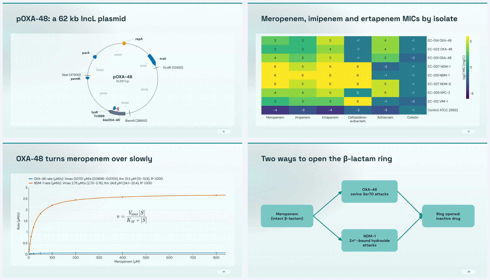
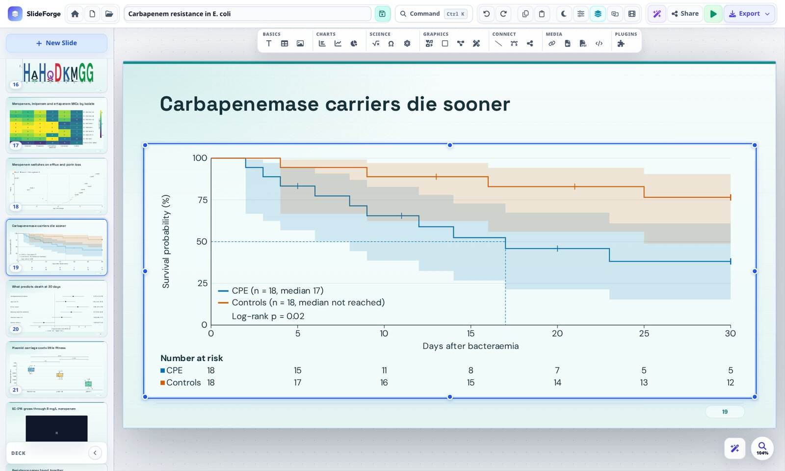
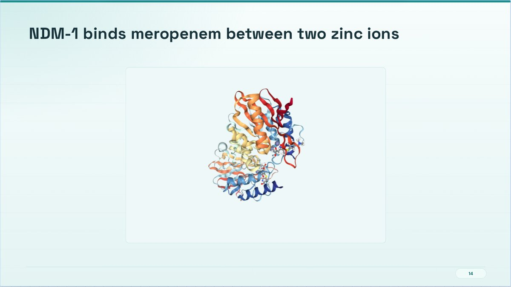
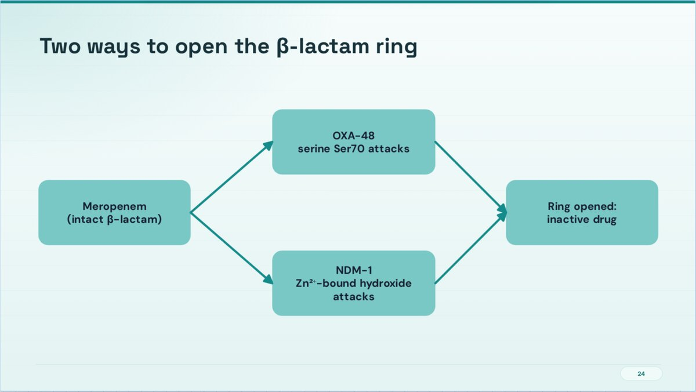
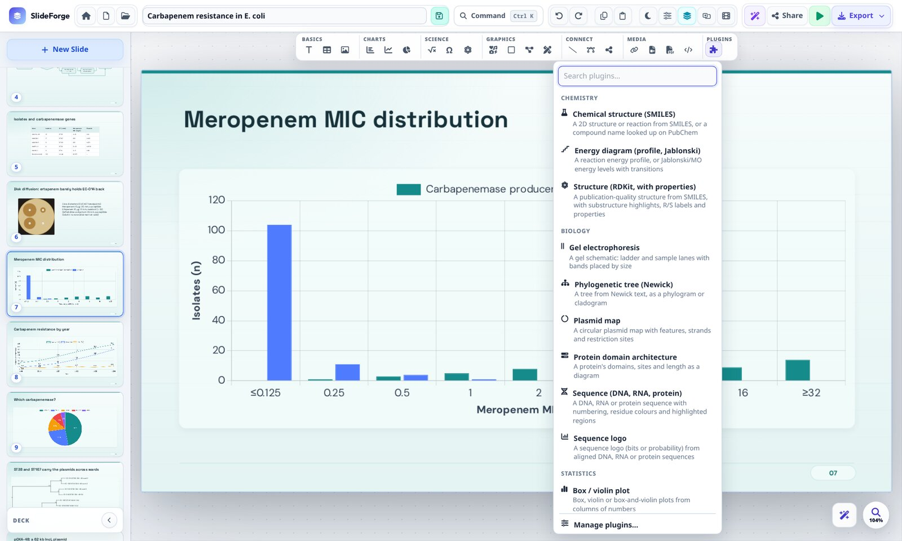

<div align="center">

# SlideForge

**Slides for people who present science.**

Charts you can edit, equations that look right, molecules you can turn, and plots that fit their own curves,
all on one canvas, then out to PowerPoint or PDF.

[Install](#install) · [What you can make](#what-you-can-make) · [Desktop app](docs/DESKTOP.md) · [Plugins](docs/PLUGINS.md) · [Develop](docs/DEVELOPMENT.md)



</div>

## Why SlideForge

Most slide tools treat a figure as a picture you paste in. SlideForge treats it as something you build: paste a
table and get a chart, type a SMILES string and get a structure, drop in a PDB file and get a molecule you can
rotate during your talk. Change a number and the figure follows.

- **Free and on your computer.** Your decks stay in a folder on your machine. No account, no upload.
- **Made for figures.** 26 built-in science tools, from survival curves to gels, so the figure is born on the slide
  instead of being pasted in from a screenshot.
- **Fits the rest of your world.** Open PowerPoint files, export editable PowerPoint (charts stay charts), searchable
  PDF, or a web page that plays offline.



## What you can make

| | |
|---|---|
| **Charts and tables** | Paste a block from a spreadsheet: it becomes a bar, line or pie chart with axis titles, error bars and values on the chart. A long table splits across slides with its header repeated. |
| **Equations** | Type LaTeX, get a crisp equation that exports as a picture PowerPoint can show. |
| **Molecules** | Open a PDB, CIF, XYZ or trajectory file and turn it with the mouse while you present. Bound drugs and metal ions are drawn so the room can see them. |
| **Chemistry** | Structures and reactions from SMILES or a compound name, RDKit drawings with properties, energy diagrams. |
| **Biology** | Plasmid maps, protein domains, sequences and sequence logos, phylogenetic trees, gels. |
| **Statistics** | Box and violin plots with tests, curve fits (dose–response, Michaelis–Menten, decay) with their units, forest plots, Kaplan–Meier curves, volcano plots, heatmaps, Venn diagrams. |
| **Diagrams** | Flowcharts you draw or type (Mermaid), shapes joined by arrows that follow them, and hand-drawn sketches. |
| **Media** | Pictures you can crop, looping videos, PDF pages, web embeds. |
| **References** | A citation from a DOI, a QR code to the paper, a scale bar for a micrograph. |

<p align="center">
  
  
</p>

## Present it

- Full-screen show with a presenter view, notes and a timer.
- Bullets that appear one at a time, and diagrams that build in the order you choose.
- A laser pointer, spotlight and chalkboard for the questions afterwards.
- A view-only link to share the deck, which follows your later edits and can be switched off.



## Install

**Linux and macOS:** paste this into a terminal.

```bash
curl -fsSL https://raw.githubusercontent.com/dmighty007/slideforge-studio/main/install.sh | sh
```

**Windows:** paste this into PowerShell.

```powershell
irm https://raw.githubusercontent.com/dmighty007/slideforge-studio/main/install.ps1 | iex
```

That's all: SlideForge appears in your applications menu and as an icon on your desktop. No administrator rights,
no Python to set up first. It installs the latest version from this repository; run the same line again to update.
Add `--uninstall` (`... | sh -s -- --uninstall`) to remove it. Your presentations stay on your computer either way.

Prefer pip? `pip install "slideforge-studio[qt]"` (drop `[qt]` on macOS and Windows) installs the latest release
from PyPI, then `slideforge`, and `slideforge --install-shortcut` for the icons. More in
[docs/DESKTOP.md](docs/DESKTOP.md).

To run it from this repository instead, or to help build it, see [docs/DEVELOPMENT.md](docs/DEVELOPMENT.md).

## Extend it

New kinds of slide objects are plugins: a small JavaScript file that draws from a few settings. Install one from a
.zip in the Plugins dialog, or write your own with [docs/PLUGINS.md](docs/PLUGINS.md).

## License

SlideForge is free software under the [GNU Affero General Public License v3.0 or later](LICENSE). It builds on
PyMuPDF, which is offered under the same licence. Bundled libraries and fonts, and their licences, are listed in
[THIRD_PARTY_NOTICES.md](THIRD_PARTY_NOTICES.md).
