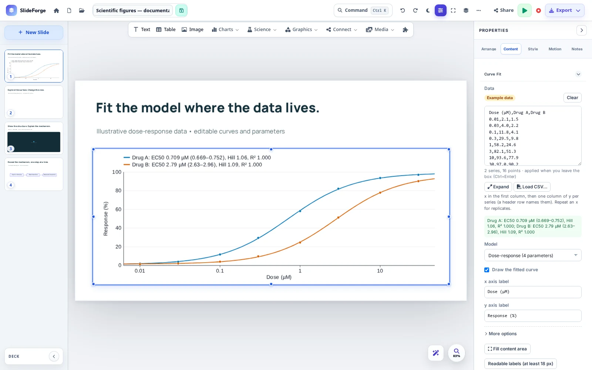
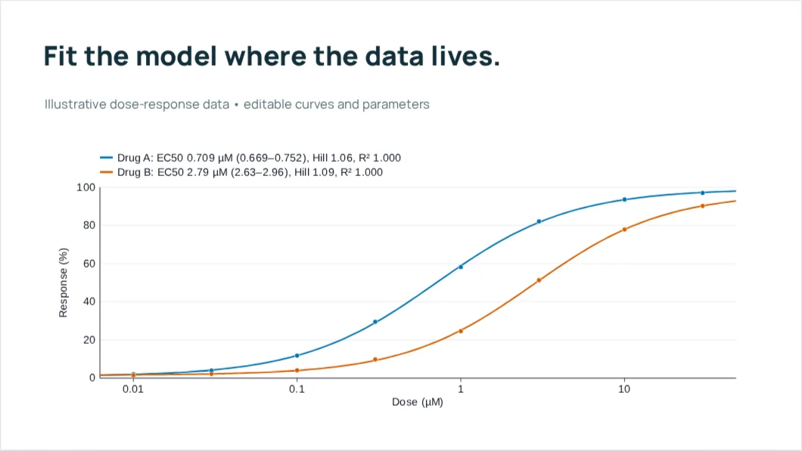
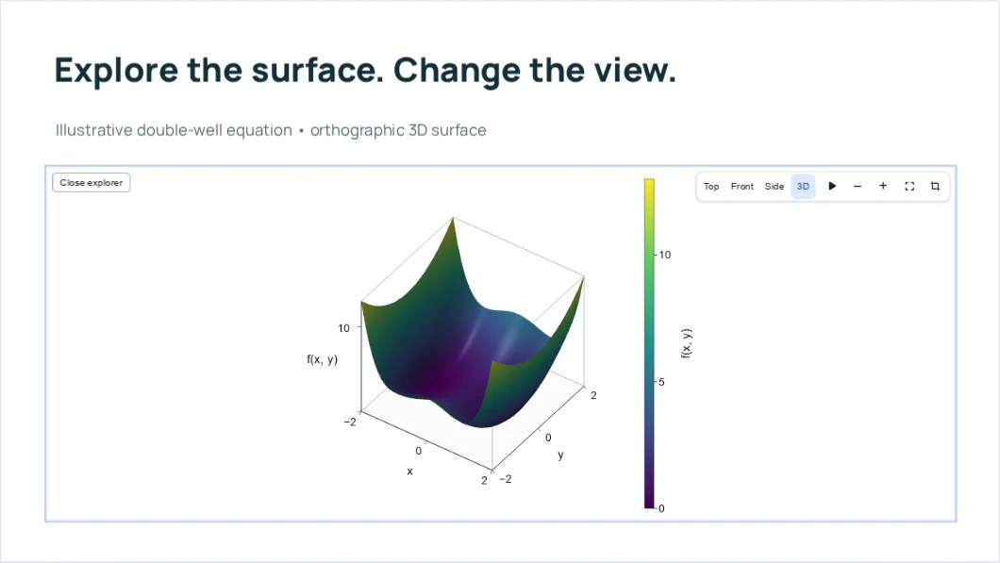
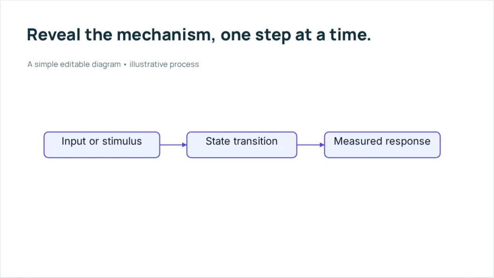

A presentation workspace for research

# Scientific figures. Presentation ready.

Build charts, equations, molecular views and diagrams directly on your slides. Keep the scientific inputs editable, then present the story or export a copy.

[Install SlideForge](install.md){ .md-button .md-button--primary }
[See it in action](showcase/index.md){ .md-button }

<figure class="sf-product-shot">

</figure>

Real application capture. The dose-response values are illustrative.

Linux, macOS &amp; WindowsLocal desktop storageNo account required for desktop useFree &amp; open source

Start with your next talk

## A shorter path from input to explanation

<a class="sf-path" href="install/">
01 / SET UP
<h3>Install the desktop app</h3>

Choose your operating system, install once, and open a local workspace.

Get the app →
</a>
<a class="sf-path" href="getting-started/">
02 / MAKE SOMETHING
<h3>Build your first presentation</h3>

Add a figure, change its inputs, and try a short presentation.

Follow the walkthrough →
</a>
<a class="sf-path" href="showcase/">
03 / EXPLORE
<h3>Play through the examples</h3>

See scientific figures and click-by-click animation builds in the browser.

Open the showcase →
</a>

The figure and the story, together

## Work with scientific objects

Charts, structures and surfaces can carry their inputs with them in the native deck.

<a href="features/">Explore the capabilities →</a>

<section class="sf-feature" markdown="1">
<figure></figure>

Build from data

### Keep the figure editable

Paste a table, edit a chart, fit a supported model, or enter a LaTeX equation. Scientific plugins add heatmaps, survival curves, chemical structures, maps and more.

CHARTS &amp; TABLESCURVE FITSLATEX

[Find the right tool →](features.md#data-and-figures)

</section>

<section class="sf-feature sf-feature--reverse" markdown="1">

Explore during the explanation

### Turn a view into a conversation

Rotate a molecular structure, step through a matching trajectory, or inspect a landscape. The native app keeps the controls available while you present.

MOLECULESTRAJECTORIES3D SURFACES

[Use live scientific objects →](guides/scientific-objects.md)

<figure></figure>
</section>

<section class="sf-feature" markdown="1">
<figure></figure>

Present deliberately

### Reveal one idea at a time

Use diagram builds, grouped click reveals and slide transitions. Add speaker notes, rehearse with a timer, and record a supported slide show locally.

CLICK BUILDSPRESENTER VIEWTIMER &amp; RECORDING

[Prepare the presentation →](guides/presenting.md)

</section>

An existing deck is a starting point

## Bring it in. Keep a source. Share a copy.

<b>01</b><strong>Import</strong>
Open PowerPoint or Keynote and review the result.

<b>02</b><strong>Edit</strong>
Work with supported text, figures and scientific objects.

<b>03</b><strong>Present</strong>
Explain with notes, builds and native live views.

<b>04</b><strong>Export</strong>
Choose PowerPoint, PDF or an offline web presentation.

The native SlideForge deck is your editable scientific master. PowerPoint preserves supported text, shapes, tables and charts; specialized visuals may become images. PDF is static. Browser exports retain supported interactions, but Landscape Explorer uses a saved still.

[Check format support and limitations →](guides/import-export.md)

## Make your next research story here.

Start with one figure, one structure, or one mechanism you want to explain.

[Install SlideForge](install.md){ .md-button .md-button--primary }
[Your first presentation](getting-started.md){ .md-button }

