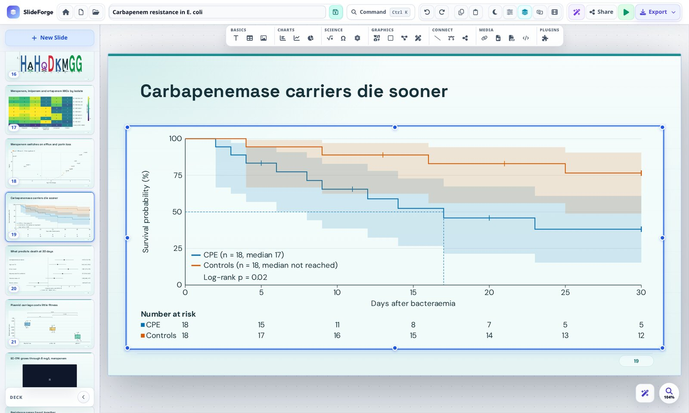
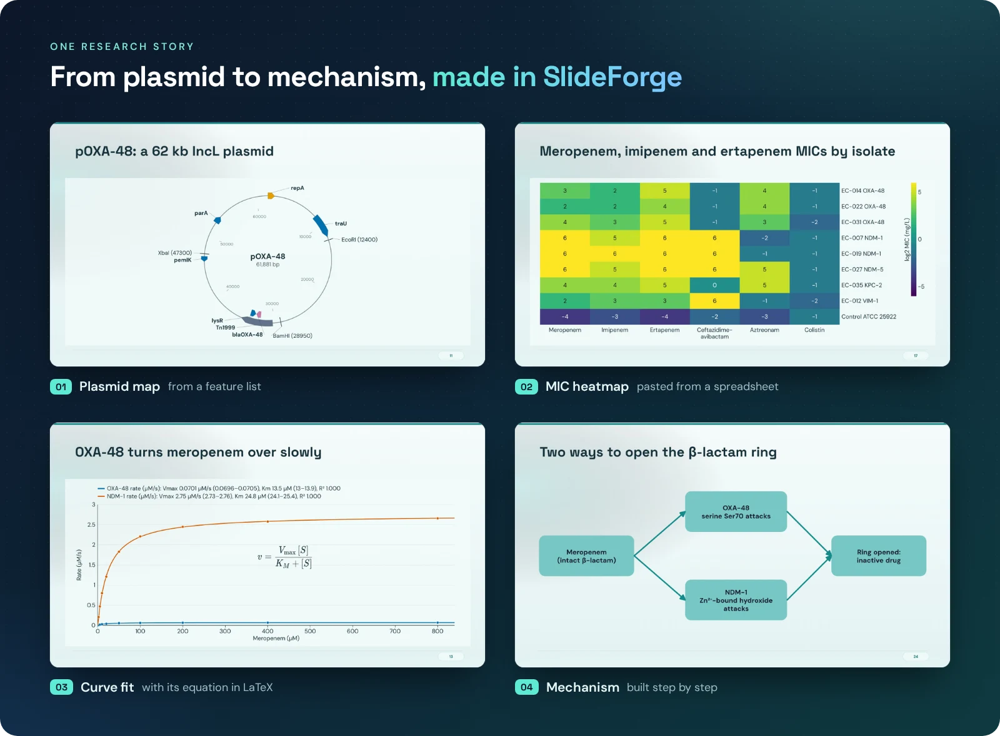
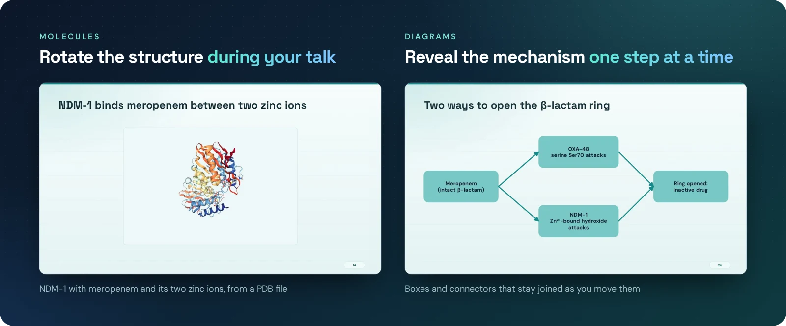

Built for science

# Scientific figures. Presentation ready.

The free desktop presentation app for researchers, teachers and students. Build charts, equations
and molecular views directly on your slides, then present them or take them to PowerPoint and PDF.

[Install SlideForge :material-download:](install.md){ .md-button .md-button--primary }
[Explore examples](showcase/index.md){ .md-button }

Linux · macOS · Windows &nbsp; / &nbsp; Free and open source · No account required

## Start here

-   **1. Install the app**

    Choose the instructions for your operating system. [Install SlideForge →](install.md)

-   **2. Make your first presentation**

    Add a slide, insert a figure, and try presenting. [Follow the walkthrough →](getting-started.md)

-   **3. Explore what is possible**

    Browse scientific figures and step-by-step animations. [Explore the showcase →](showcase/index.md)

## Build the figure on the slide

Most slide tools treat a figure as a picture you paste in. SlideForge treats it as something you build: paste a
table and get a chart, type a SMILES string and get a structure, open a PDB file and get a molecule you can rotate
during your talk. Change a number and the figure follows.

-   :material-chart-bar:{ .lg } **Charts and fits**

    ---

    Paste a block from a spreadsheet for a bar, line or pie chart. Fit dose–response, kinetics or exponential models
    and show the parameters with their confidence intervals.

-   :material-function-variant:{ .lg } **Equations**

    ---

    Type LaTeX and get a typeset equation that exports as a sharp picture to PowerPoint and PDF.

-   :material-molecule:{ .lg } **Molecules**

    ---

    Proteins from PDB files, small molecules from SMILES, trajectories that play. Turn them live while you present.

-   :material-puzzle:{ .lg } **26 science plugins**

    ---

    Survival curves, volcano plots, heatmaps, plasmid maps, phylogenetic trees, gels, Feynman diagrams, circuits and
    more, each drawn from a few settings. [Write your own](PLUGINS.md).

-   :material-animation-play:{ .lg } **Builds and transitions**

    ---

    Reveal a mechanism step by step: over sixty entrance, emphasis, exit and motion effects, and slide transitions.

-   :material-swap-horizontal:{ .lg } **Fits the rest of your world**

    ---

    Open PowerPoint and Keynote files. Export editable PowerPoint (charts stay charts), searchable PDF, or a web page
    that plays offline, like the decks in the [showcase](showcase/index.md).

## One research story

## Free, and on your computer

Your decks stay in a folder on your machine. The desktop app needs no account, and it runs on Linux, macOS and
Windows. [Install it in one line](install.md), or read the [desktop guide](DESKTOP.md).
