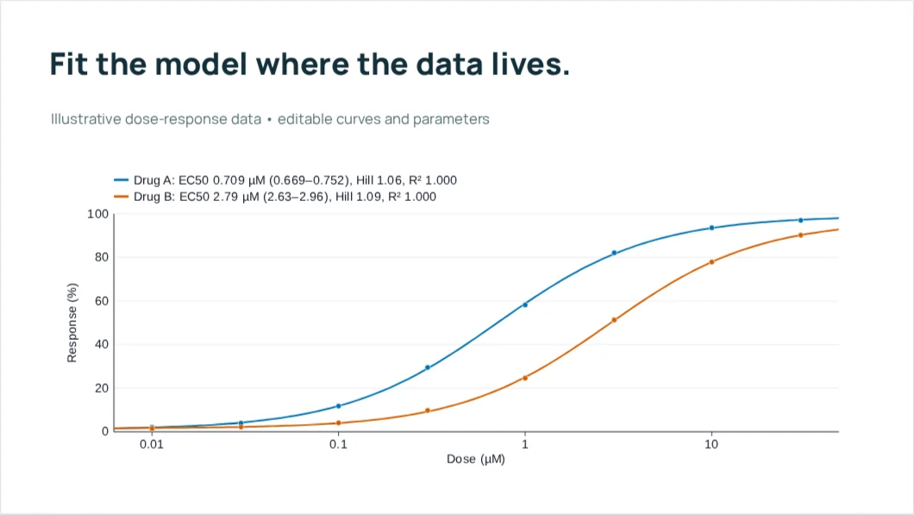
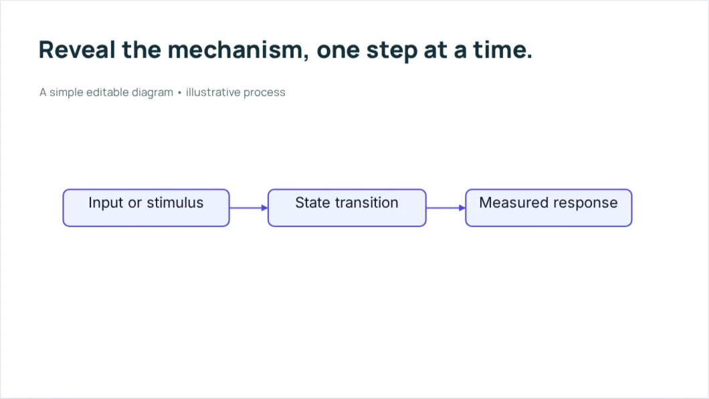

Made in SlideForge

# See the figures. Try the presentation.

These decks were built with the actual editor and exported through Web (ZIP). Open one to try the supported viewer interactions and click-by-click builds.

<article class="sf-showcase">

12 slides / scientific figures

<h2><a href="capabilities/">Explore the capabilities</a></h2>

Charts, fits, survival curves, heatmaps, volcano plots, plasmid maps, trees, chemistry, a rotatable protein and physics diagrams.

<a class="md-button md-button--primary" href="capabilities/">Play the capabilities deck →</a>

</article>
<article class="sf-showcase">

9 slides / motion and builds

<h2><a href="animations/">Try a click-by-click story</a></h2>

Entrances, emphasis, exits, motion paths, drawing effects, progressive lists and flowcharts that unfold.

<a class="md-button md-button--primary" href="animations/">Play the animation deck →</a>

</article>

## How to explore

Click inside the presentation, then use **→** and **←** to move through builds and slides. On the molecular example, drag the protein to turn it. For more space, open a deck in a new tab and use its presentation menu.

The screenshots above are current editor examples; the playable decks demonstrate a broader set of objects. Scientific values are illustrative.

!!! note "A viewer is not the source editor"
    The native SlideForge deck keeps editable scientific inputs. PowerPoint and PDF can use still images for specialized objects. Standalone HTML retains supported viewer interactions, but Landscape Explorer is currently a saved still. See [format support](../guides/import-export.md).

## Build a version with your own data

[Install SlideForge](../install.md){ .md-button .md-button--primary }
[Follow the first-presentation guide](../getting-started.md){ .md-button }

??? info "How the playable examples are made"
    Both decks are rebuilt with the real editor for site deployment using
    [tools/build-showcase.cjs](https://github.com/dmighty007/slideforge-studio/blob/main/tools/build-showcase.cjs).
    The page screenshots are captured separately with
    [tools/capture-docs-visuals.cjs](https://github.com/dmighty007/slideforge-studio/blob/main/tools/capture-docs-visuals.cjs)
    and committed as optimized WebP files.
